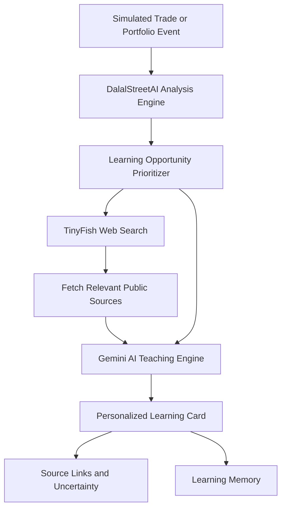
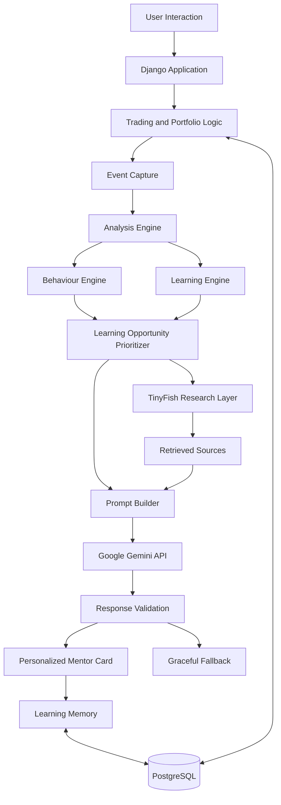

# 📈 DalalStreetAI
### India's AI-Powered Stock Market Learning Platform

**Learn investing by doing. Build better decisions without risking real money.**

DalalStreetAI is a gamified stock market learning platform designed for beginner investors in India. It enables users to explore 425+ NSE-listed stocks, practise trading with virtual money, analyse portfolio decisions, and learn through personalized AI mentorship.

Unlike traditional stock simulators and stock-tip chatbots, DalalStreetAI focuses on **decision quality, financial literacy, and behavioural learning—not stock-price predictions or buy/sell recommendations.**

Our hackathon direction adds **TinyFish-powered web research** to connect simulated trading decisions with relevant company news, financial disclosures, and other public information, helping learners understand real-world context.

🌐 **Live Demo:** [Try DalalStreetAI](https://dalal-street-ai.onrender.com)  
💻 **GitHub Repository:** [DalalStreetAI](https://github.com/InderjotSingh17/DalalStreetAI)

---

## 🎯 The Problem

Beginner investors often face four challenges:

- **Theory without practice:** Courses and articles explain market concepts but rarely provide personalized feedback on actual decisions.
- **Real money, real risk:** Beginners may enter the market without understanding valuation, diversification, risk, or behavioural biases.
- **Profit doesn't always mean a good decision:** A profitable trade can result from luck, while a well-reasoned decision can still lose money.
- **Generic financial guidance:** Traditional learning tools rarely connect an individual's trading history, portfolio, behaviour, and relevant company information.

### The core gap

Beginners need more than stock tips. They need to understand **why an investment decision makes sense, what risks to consider, and what they can learn from it—before risking real money.**

## 💡 Our Solution

DalalStreetAI combines stock market simulation, personalized AI mentorship, gamified learning, and a research-oriented learning experience.

### Our core principles

- 📊 **Practise without real-money risk:** Explore NSE-listed stocks using virtual capital.
- 🧠 **Understand your decisions:** Analyse trades, portfolio concentration, valuation, risk, and behaviour.
- 🌐 **Connect decisions with real-world context:** Use the planned TinyFish research layer to retrieve relevant public information.
- 🎯 **Learn one important concept at a time:** Prioritize the most relevant learning opportunity instead of overwhelming users.
- 🔁 **Build continuity:** Use learning memory to track previously taught concepts and recurring patterns.

The goal is not to encourage more trading. It is to help people develop better financial decision-making habits.

---

## ✨ Key Features

### 📊 1. Stock Market Simulator

- Explore **425+ NSE-listed stocks**.
- Search, filter, and sort stocks by sector, price, price change, and market capitalization.
- View market indices, including NIFTY 50, SENSEX, and BANKNIFTY.
- Explore stock fundamentals such as P/E, EPS, ROE, P/B, debt-to-equity, dividend yield, and market capitalization.
- View interactive stock price charts and 52-week ranges.
- Execute simulated buy and sell orders using virtual money.
- Track holdings, portfolio valuation, profit and loss, and sector allocation.
- Maintain a personal watchlist and review order history.
- Explore contextual explanations of financial metrics using stock data.

### 🧠 2. Event-Driven AI Teaching Engine

The AI Teaching Engine is the core differentiator of DalalStreetAI.

Rather than waiting for a user to ask a question, the system is designed to respond to meaningful events such as buying a stock, selling a stock, or viewing a portfolio.

**How the teaching pipeline works:**

1. **Event Capture:** Capture trade details and portfolio context.
2. **Analysis Engine:** Evaluate fundamentals, valuation, concentration, entry timing, risk, and potential behavioural patterns.
3. **Learning Engine:** Consider previously taught concepts and recurring learning needs.
4. **Prioritization:** Select the most important learning opportunity using deterministic logic.
5. **Contextual Teaching:** Use Google Gemini to explain the selected concept in accessible language.
6. **Learning Memory:** Record concepts already taught and use historical patterns to inform future lessons.

The result is a focused, personalized learning experience rather than another generic financial chatbot.

### 🎯 3. Decision Quality Over Profit

A profitable trade is not necessarily a good decision, and a losing trade is not necessarily a bad decision.

DalalStreetAI focuses on the reasoning, risk awareness, and behaviour behind simulated trading decisions rather than judging them solely by their financial outcome.

Potential patterns to analyse include:

- FOMO buying
- Panic selling
- Overtrading
- Premature profit-taking
- Sector concentration
- Entry timing and valuation awareness
- Disciplined holding behaviour

These are learning signals, not clinical or definitive assessments of a user's behaviour.

### 🌐 4. TinyFish-Powered Web Research — Hackathon Integration

TinyFish is intended to provide the web-research layer that connects simulated trading decisions with relevant public financial information.

The goal is to move beyond isolated portfolio metrics and help users investigate the real-world context surrounding their learning opportunities.

**Research workflow:**

1. **Identify a learning opportunity:** DalalStreetAI analyses a simulated trade, portfolio, or recurring pattern.
2. **Search with TinyFish:** Find relevant company news, financial disclosures, and public web sources.
3. **Fetch relevant content:** Retrieve useful source information for further analysis.
4. **Generate a contextual lesson:** Google Gemini combines the user's simulated trading context with retrieved information.
5. **Present evidence and uncertainty:** Show source links and explain what the information may mean, what remains uncertain, and what the learner could investigate next.

**Example use case**

A beginner purchases a stock without researching recent company developments.

DalalStreetAI identifies an opportunity to teach research and decision-making. TinyFish can search for relevant public information, while the AI Teaching Engine uses the retrieved evidence to explain how those developments may relate to the learner's decision.

News headlines are not treated as proof of why a stock moved, and retrieved information is not used to predict future returns.

### 🎮 5. Gamified Learning

- Earn experience points through supported activities.
- Progress through seven experience levels, from Beginner to Legend.
- Complete daily and one-time missions.
- Compete with other users on a portfolio-value leaderboard.

Gamification is intended to make financial learning more engaging without making trading frequency the primary measure of success.

### 💬 6. AI Portfolio Mentor

Users can ask questions about investing concepts, portfolio concentration, risk, and trading behaviour.

The conversational mentor is designed to use relevant portfolio and trading history, along with previously taught concepts, to provide more contextual explanations and reduce unnecessary repetition.

### 📅 7. Daily and Weekly Learning Reports

- **Daily Mentor Report:** Reviews the day's notable decisions, potential mistakes, and concepts worth revisiting.
- **Weekly Behavioural Review:** Highlights recurring patterns and areas for improvement.
- **Learning Profile:** Tracks concepts taught, reinforced lessons, behavioural patterns, and decision-quality trends.

### 🛡️ 8. Reliability and Graceful Fallbacks

The existing platform architecture includes reliability-oriented features such as:

- Retry logic for AI service failures.
- Response validation before AI-generated content reaches the interface.
- Fallback mentor cards when AI responses are unavailable.
- Caching to reduce unnecessary repeated AI requests.
- Environment-based management of API keys and database credentials.

The TinyFish integration should follow similar principles, including handling failed requests, missing sources, and unavailable external services.

---

## 🔄 TinyFish Research Workflow



The workflow is designed to connect three elements:

**Personal context + external evidence + focused AI teaching.**

Python-based analysis selects the learning opportunity. TinyFish supplies relevant web research, and Gemini generates a contextual explanation. The system is designed for financial education rather than automated investment decisions.

---

## 🏗️ System Architecture



### Architecture principles

- **Deterministic analysis:** Python-based logic identifies potential learning opportunities.
- **Contextual AI:** Gemini explains selected concepts rather than independently making financial decisions.
- **Evidence-oriented research:** TinyFish is intended to retrieve relevant public information for contextual lessons.
- **Learning continuity:** Learning memory tracks concepts and recurring patterns.
- **Graceful degradation:** The platform should remain useful when external AI or research services are unavailable.

*The TinyFish branch represents the planned integration architecture until verified in the running application.*

---

## 🛠️ Technology Stack

| Component | Technology |
|---|---|
| Backend | Python, Django |
| Frontend | HTML, CSS, JavaScript, Django Templates |
| Database | PostgreSQL, SQLite fallback |
| Market Data | Yahoo Finance via `yfinance` |
| AI Teaching Engine | Google Gemini API |
| Web Research | TinyFish Search and Fetch capabilities |
| Charts | Chart.js |
| Task Scheduling | APScheduler |
| Deployment | Render |
| Version Control | Git and GitHub |

---

## 🧩 AI Teaching Engine Modules

The Teaching Engine separates analytical logic from AI-generated explanations.

| Module | Responsibility |
|---|---|
| Event Engine | Captures trade and portfolio events |
| Learning Engine | Tracks taught concepts and selects future lessons |
| Behaviour Engine | Analyses potential behavioural patterns from trading history |
| Analysis Engine | Identifies valuation, risk, concentration, and behavioural issues |
| Prioritizer | Selects the highest-priority teaching point |
| Prompt Builder | Builds focused instructions for the AI model |
| LLM Service | Handles AI requests, retries, validation, and caching |
| Card Generator | Produces consistent mentor-card responses |
| Orchestrator | Coordinates the teaching pipeline |
| TinyFish Research Layer | Intended to search and retrieve relevant public web information |

This modular architecture supports maintainability and makes it possible to extend the platform with additional research sources and learning capabilities.

---

## 🚀 Getting Started

Follow these steps to run DalalStreetAI locally.

### Prerequisites

- Python installed
- Git installed
- PostgreSQL database, or SQLite for local development
- Google Gemini API key for AI-powered features
- TinyFish API access for the research integration

### 1. Clone the repository

```bash
git clone https://github.com/InderjotSingh17/DalalStreetAI.git
cd DalalStreetAI
```

### 2. Create a virtual environment

```bash
python -m venv .venv
```

Activate it on Windows:

```powershell
.venv\Scripts\Activate.ps1
```

Or on macOS/Linux:

```bash
source .venv/bin/activate
```

### 3. Install dependencies

```bash
pip install -r requirements.txt
```

### 4. Configure environment variables

Create a `.env` file in the project root and configure the variables expected by your Django settings and integration code.

Example:

```env
SECRET_KEY=your_django_secret_key
DEBUG=True
GEMINI_API_KEY=your_gemini_api_key
DATABASE_URL=your_database_url
```

Configure TinyFish credentials using the environment-variable names required by your actual TinyFish integration code. Do not assume a variable name unless the application implements it.

If the project supports SQLite fallback, configure the database accordingly.

**Security reminders:**

- Never commit `.env` files or API keys to GitHub.
- Keep production credentials outside source control.
- Use environment variables for deployment secrets.
- Never expose private API keys in frontend JavaScript or public logs.

### 5. Apply database migrations

```bash
python manage.py migrate
```

### 6. Create a superuser (optional)

```bash
python manage.py createsuperuser
```

### 7. Start the development server

```bash
python manage.py runserver
```

Open the local development URL displayed in your terminal, usually:

`http://127.0.0.1:8000/`

---

## 📈 Development Status

DalalStreetAI has an existing product foundation, including the simulator, gamification, AI Teaching Engine, learning memory, and learning reports. Production status should be confirmed against the current deployment.

| Component | Status |
|---|---|
| Stock simulator, portfolio, and orders | Existing core feature |
| Watchlist and stock fundamentals | Existing core feature |
| Gamification and leaderboard | Existing core feature |
| Rule-based portfolio analysis | Existing core feature |
| AI Teaching Engine | Existing core feature |
| Decision-quality analysis | Existing core feature |
| Learning memory and reinforcement | Existing core feature |
| AI chat and mentor reports | Existing core feature |
| Learning profile and trend indicators | Existing core feature |
| TinyFish research workflow | existing |
| End-to-end TinyFish-to-learning-card test | existing |
| Latest production deployment | existing |

Feature labels describe the documented project foundation; they do not independently guarantee that every feature is available in the current live deployment.

---

## 🧪 How We Plan to Evaluate Impact

DalalStreetAI aims to measure whether users become more informed, not simply whether they execute more trades.

Potential evaluation metrics include:

- Improvement in pre- and post-learning assessment scores.
- Reduction in repeated behavioural mistakes during simulated trading.
- Percentage of users completing learning journeys.
- User feedback on the relevance and clarity of personalized lessons.
- Percentage of research-assisted lessons with usable source links.
- Reliability of the TinyFish research workflow and its graceful fallback behaviour.

These are proposed evaluation metrics, not measured results.

---

## 🔐 Financial Safety and Design Principles

DalalStreetAI is designed as an educational simulation.

- Trades use virtual money rather than real capital.
- The platform focuses on financial literacy and decision-making.
- The Teaching Engine is not designed to predict stock-price movements.
- The platform does not recommend specific stocks to buy or sell.
- AI-generated explanations supplement analytical logic rather than replacing it.
- External information should be presented with context and uncertainty.
- News and disclosures should not be treated as proof of causation or future performance.

**Disclaimer:** DalalStreetAI is an educational project, not a financial advisory service. Market data may be delayed, incomplete, or inaccurate. Nothing on the platform should be interpreted as a recommendation to invest real money.

---

## 🔮 Future Scope

### 1. Evidence-Grounded Financial Learning

Expand the TinyFish research workflow to retrieve relevant company news, financial disclosures, and other public sources for contextual learning.

### 2. Adaptive Learning Paths

Develop learning paths that adjust to users' knowledge gaps, previous lessons, and recurring patterns in simulated decisions.

### 3. Regional-Language Mentorship

Make financial concepts accessible to more learners through explanations in additional Indian languages.

### 4. Institutional Learning Analytics

Explore classroom simulations, student learning dashboards, and cohort-level progress reports for colleges and financial-literacy programmes.

### 5. Improved Evaluation and Reliability

Expand automated testing, source-quality checks, monitoring, and measurement of learning outcomes.

---

## 🌟 What Makes DalalStreetAI Different?

| Traditional Stock Simulator | DalalStreetAI |
|---|---|
| Primarily displays portfolio performance | Focuses on decision quality and learning |
| Often provides generic financial explanations | Uses actual trade and portfolio context |
| Usually reacts when users request information | Designed to trigger lessons after key events |
| Treats profit as a primary success measure | Separates decision reasoning from trade outcomes |
| Limited learning continuity | Tracks previously taught concepts and recurring patterns |
| May not connect learning with external research | Plans to connect simulated decisions with relevant web sources through TinyFish |

---

## 💼 Business Model and Startup Potential

DalalStreetAI could develop into a financial-literacy platform for individuals and educational institutions.

### B2C — Individual Learners

**Freemium model (proposed)**

- Free stock simulation and introductory lessons.
- Potential premium features such as advanced AI mentorship, personalized learning paths, behavioural reports, and detailed progress tracking.
- Proposed pricing to be validated through user research and pilot testing.

### B2B — Educational Institutions

Potential partnerships with:

- Colleges and universities.
- Student finance and investment clubs.
- Financial-literacy programmes.
- Educational technology platforms.

Possible offerings include classroom simulations, learning dashboards, and cohort-level progress reports.

These are proposed business opportunities, not existing revenue or confirmed partnerships.

---

## 👨‍💻 Author

**Inderjot Singh**

B.Tech Computer Science & Engineering — AI/ML

- GitHub: [@InderjotSingh17](https://github.com/InderjotSingh17)
- LinkedIn: [Inderjot Singh](https://www.linkedin.com/in/inderjot-singh-0471a6237)

---

## 🤝 Contributions

Contributions, suggestions, bug reports, and feature requests are welcome.

To contribute:

1. Fork the repository.
2. Create a feature branch.
3. Commit your changes.
4. Push your branch.
5. Open a pull request describing your changes.

---

Our objective is to help beginners understand investment decisions before they risk real money.

**Built with Python, Django, and AI — to help people learn investing before risking real money.** 📈
