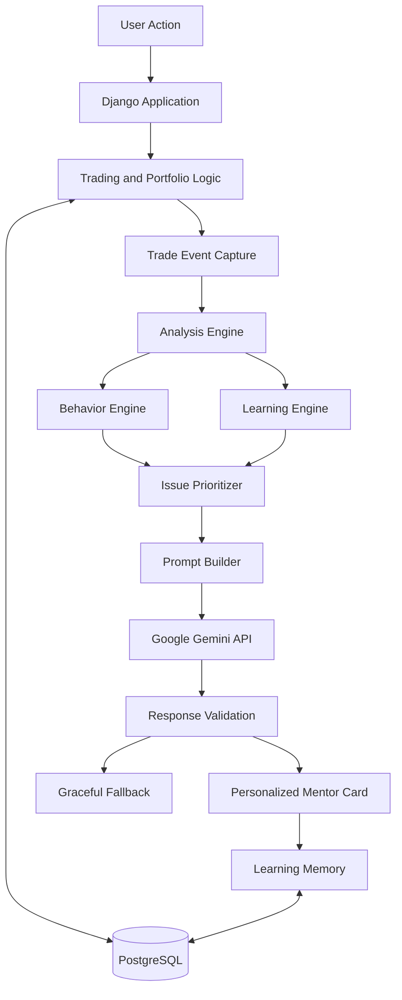

# 📈 Dalal Street AI
### India's AI-Powered Stock Market Learning Platform

**Learn investing by doing. Build better decisions without risking real money.**

Dalal Street AI is a gamified stock market simulator designed for beginner investors in India. It lets users trade real NSE-listed stocks using virtual money while an AI-powered mentor analyzes their decisions and teaches them how to think critically about investing.

Unlike traditional stock simulators and stock-tip chatbots, Dalal Street AI focuses on **improving the decision-making process, not predicting stock prices or recommending trades.**

🌐 **Live Demo:** [Try Dalal Street AI](https://dalal-street-ai.onrender.com)  
💻 **GitHub Repository:** [DalalStreetAI](https://github.com/InderjotSingh17/DalalStreetAI)

---

## 🎯 The Problem

Beginner investors often face two challenges:

- **Learning without practice:** Articles and courses teach concepts but rarely provide personalized feedback based on real decisions.
- **Practicing with real money:** New investors may make uninformed decisions before understanding valuation, diversification, risk, or behavioral biases.

Dalal Street AI bridges this gap with a realistic trading simulator, virtual capital, and an AI mentor that turns actual trading decisions into personalized learning experiences.

## 💡 Our Solution

Dalal Street AI combines three core ideas:

- 📊 **Stock Market Simulator:** Practice trading real NSE-listed stocks with virtual money.
- 🧠 **AI Teaching Engine:** Receive personalized lessons based on actual trades, portfolio data, and behavioral patterns.
- 🎮 **Gamified Learning:** Earn XP, complete missions, progress through levels, and compete on a leaderboard.

The goal isn't to make users trade more. It's to help them become more informed and disciplined investors.

---

## ✨ Key Features

### 📊 1. Stock Market Simulator

- Explore **425+ NSE-listed stocks**.
- Search, filter, and sort stocks by sector, price, price change, and market capitalization.
- View market indices, including NIFTY 50, SENSEX, and BANKNIFTY.
- Analyze stock fundamentals such as P/E, EPS, ROE, P/B, Debt-to-Equity, dividend yield, and market capitalization.
- View interactive stock price charts and 52-week ranges.
- Execute virtual buy and sell orders.
- Track holdings, portfolio valuation, profit and loss, and sector allocation.
- Maintain a personal watchlist and review order history.
- Explore contextual explanations of financial metrics using a stock's actual data.

### 🧠 2. Event-Driven AI Teaching Engine

The AI Teaching Engine is the core differentiator of Dalal Street AI.

Instead of waiting for users to ask questions, it responds to important events such as buying a stock, selling a stock, or viewing a portfolio.

**How it works:**

1. **Event Capture:** Captures trade details and the user's portfolio context.
2. **Analysis Engine:** Evaluates valuation, fundamentals, concentration, entry timing, risk, and behavioral patterns.
3. **Prioritization:** Selects the single most important issue to address.
4. **Contextual Teaching:** Uses Google Gemini to explain the issue in plain language, grounded in the user's actual decision and financial data.
5. **Learning Memory:** Records concepts already taught and identifies recurring mistakes in future decisions.

The result is a focused, personalized lesson rather than a generic financial explanation.

### 🎯 3. Decision Quality Over Profit

A profitable trade isn't necessarily a good decision, and a losing trade isn't necessarily a bad one.

Dalal Street AI evaluates the reasoning behind a decision rather than judging it solely by its financial outcome.

The system identifies potential behavioral patterns such as:

- FOMO buying
- Panic selling
- Overtrading
- Premature profit-taking
- Sector concentration
- Disciplined holding behavior

### 🎮 4. Gamification System

- Earn experience points through trading activity and daily engagement.
- Progress through seven experience levels, from Beginner to Legend.
- Complete nine daily and one-time missions.
- Compete with other users on a portfolio-value leaderboard.

### 💬 5. AI Portfolio Mentor

Ask questions about investing concepts, portfolio concentration, risk, and trading behavior.

The conversational mentor has access to relevant portfolio and trading history and takes previously taught concepts into account to reduce repetitive explanations.

### 📅 6. Daily and Weekly Reports

- **Daily Mentor Report:** Reviews the day's best decision, biggest mistake, and concepts worth revisiting.
- **Weekly Behavioural Review:** Identifies recurring patterns and provides a focused area for improvement.
- **Learning Profile:** Tracks concepts taught, reinforced lessons, behavioral patterns, and decision-quality trends.

### 🛡️ 7. Reliability and Graceful Fallbacks

- Retry logic for AI service failures.
- Response validation before AI-generated content reaches the interface.
- Fallback mentor cards when AI responses are unavailable.
- Caching to reduce unnecessary repeated AI requests.
- Environment-based management of API keys and database credentials.

---

## 🏗️ System Architecture



The analytical logic remains in Python. The AI model is used primarily to explain a selected teaching point in natural language rather than independently making financial decisions.

---

## 🛠️ Tech Stack

| Component | Technology |
|---|---|
| Backend | Python, Django |
| Frontend | HTML, CSS, JavaScript, Django Templates |
| Database | PostgreSQL, SQLite fallback |
| Market Data | Yahoo Finance via `yfinance` |
| AI / LLM | Google Gemini API |
| Charts | Chart.js |
| Task Scheduling | APScheduler |
| Deployment | Render |
| Version Control | Git and GitHub |

---

## 🧩 AI Teaching Engine Modules

The Teaching Engine is organized into separate components coordinated through a central orchestrator.

| Module | Responsibility |
|---|---|
| Event Engine | Captures trade and portfolio events |
| Learning Engine | Tracks taught concepts and selects future lessons |
| Behaviour Engine | Detects behavioral patterns from trading history |
| Analysis Engine | Identifies valuation, risk, concentration, and behavioral issues |
| Prioritizer | Selects the highest-priority teaching point |
| Prompt Builder | Builds focused instructions for the AI model |
| LLM Service | Handles AI requests, retries, validation, and caching |
| Card Generator | Produces consistent mentor-card responses |
| Orchestrator | Coordinates the pipeline through a single entry point |

This modular architecture separates deterministic financial analysis from AI-generated explanations, making the system easier to maintain and extend.

---

## 🚀 Getting Started

Follow these steps to run Dalal Street AI locally.

### Prerequisites

- Python installed
- Git installed
- A PostgreSQL database, or SQLite for local development
- A Google Gemini API key for AI-powered features

### 1. Clone the repository

```bash
git clone https://github.com/InderjotSingh17/DalalStreetAI.git
cd DalalStreetAI
```

### 2. Create a virtual environment

```bash
python -m venv .venv
```

Activate it on Windows:

```powershell
.venv\Scripts\Activate.ps1
```

Or on macOS/Linux:

```bash
source .venv/bin/activate
```

### 3. Install dependencies

```bash
pip install -r requirements.txt
```

### 4. Configure environment variables

Create a `.env` file in the project's root directory and configure the variables expected by your Django settings.

For example:

```env
SECRET_KEY=your_django_secret_key
DEBUG=True
GEMINI_API_KEY=your_gemini_api_key
DATABASE_URL=your_database_url
```

Use the actual variable names expected by your project configuration. If the project supports SQLite fallback, configure the database accordingly.

**Important:** Never commit your `.env` file, production credentials, or API keys to GitHub.

### 5. Apply database migrations

```bash
python manage.py migrate
```

### 6. Create a superuser (optional)

```bash
python manage.py createsuperuser
```

### 7. Start the development server

```bash
python manage.py runserver
```

Open the local development URL displayed in your terminal, usually:

`http://127.0.0.1:8000/`

---

## 🔐 Financial Safety and Design Principles

Dalal Street AI is designed as an educational simulation.

- Trades use virtual money rather than real capital.
- The platform focuses on financial literacy and decision-making.
- The Teaching Engine does not predict stock-price movements.
- It does not recommend specific stocks to buy or sell.
- AI-generated explanations supplement deterministic analysis rather than replacing it.

**Disclaimer:** Dalal Street AI is an educational project, not a financial advisory service. Market data may be delayed, incomplete, or inaccurate. Nothing on the platform should be interpreted as a recommendation to invest real money.

---

## 📈 Current Development Status

The core product features have been implemented and tested, including the simulator, gamification, AI Teaching Engine, learning memory, reports, and learning profile.

| Component | Status |
|---|---|
| Stock simulator, portfolio, and orders | Complete |
| Watchlist and stock fundamentals | Complete |
| Gamification and leaderboard | Complete |
| Rule-based portfolio mentor | Complete |
| AI Teaching Engine | Complete |
| Decision-quality analysis | Complete |
| Learning memory and reinforcement | Complete |
| AI chat and mentor reports | Complete |
| Learning profile and trend indicators | Complete |
| Production hardening | Complete |
| Latest production deployment verification | Pending |

---

## 🔮 Future Scope

Potential areas for further development include:

- More comprehensive behavioral analytics.
- Expanded financial literacy lessons and learning paths.
- Improved historical portfolio simulations and benchmarking.
- More robust automated testing and monitoring.
- Enhanced accessibility and mobile responsiveness.
- Additional educational scenarios for different investor experience levels.

---

## 🌟 What Makes Dalal Street AI Different?

| Traditional Stock Simulator | Dalal Street AI |
|---|---|
| Focuses primarily on portfolio performance | Focuses on decision quality and learning |
| Provides generic financial explanations | Uses actual trades and portfolio context |
| Usually reacts only when users ask questions | Can trigger lessons automatically after key events |
| Often treats profit as the primary measure of success | Evaluates reasoning separately from outcomes |
| Limited learning continuity | Tracks previously taught concepts and recurring patterns |

---

## 👨‍💻 Author

**Inderjot Singh**

B.Tech Computer Science & Engineering — AI/ML

- GitHub: [@InderjotSingh17](https://github.com/InderjotSingh17)
- LinkedIn: [Inderjot Singh](https://www.linkedin.com/in/inderjot-singh-0471a6237)

---

## 🤝 Contributions

Contributions, suggestions, bug reports, and feature requests are welcome.

If you'd like to contribute:

1. Fork the repository.
2. Create a feature branch.
3. Commit your changes.
4. Push your branch.
5. Open a pull request describing your changes.

---

**Built with Python, Django, and AI — to help people learn investing before risking real money.** 📈
